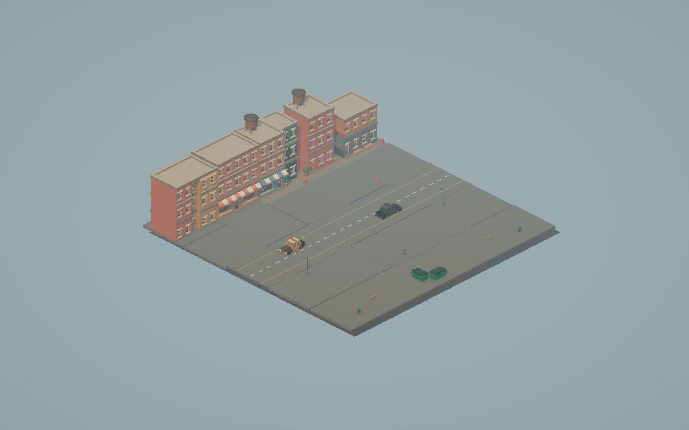

# MAJOR DAMAGE — Foundation + Low Poly Animation Update

Физическая 3D-демка на основе существующего прототипа: передвижение, прыжок,
обзор от первого лица, захват тел, повреждения от столкновений, разрушение и заработок.

Ветка `feature/lowpoly-animations`: согласованная матовая палитра, мягкий свет,
Rigidbody-анимации Idle/Walk/Run/Strafe/Jump/Fall/Landing и реакция рук при захвате.
Камера игры остаётся от первого лица. Для полного тела: **Tools → Major Damage →
Open Animation Preview**, затем Play; **1–8** выбирают режим, **P** — автоцикл.

В основной сцене **F6** включает боковую тестовую камеру, повторное нажатие
возвращает FPS; **F7** меняет сторону. Тело отбрасывает анимированную тень и в FPS.
Герой обновлён: парень в мотоциклетном шлеме, стройные пропорции по модели Lilac,
подробная одежда и расширенные книзу брюки, без Z.
[Модель и проверка камеры/тени](Documentation/RIDER_UPDATE.md).

[Архивное видео первой версии](Documentation/VisualAnimation/AnimationPreview.mp4) ·
[Настройки анимаций](Documentation/PLAYER_ANIMATIONS.md) ·
[Настройки материалов](Documentation/LOW_POLY_STYLE.md) ·
[Результаты проверки](Documentation/VISUAL_ANIMATION_VALIDATION.md)

## Запуск

1. Открыть корень репозитория в **Unity 6000.0.43f1**.
2. Дождаться импорта исходных пакетов из `Packages/manifest.json`.
3. Открыть `Assets/Game/Scenes/SampleScene.unity` и нажать Play.

Версия проекта и исходные зависимости не обновлялись. На машине разработки установлен
только 6000.6.8f1: для реальной проверки используется отдельная копия проекта с подходящими
локальными пакетами. Новые материалы, контроллер и сцены созданы через API этой
проверочной копии и перенесены в ветку; исходные ProjectVersion и зависимости
сохранены. Точный объём проверки Foundation — в `VALIDATION.md`, текущего
обновления — в `Documentation/VISUAL_ANIMATION_VALIDATION.md`.

## Управление

| Действие | Кнопки |
| --- | --- |
| Передвижение | WASD / стрелки |
| Прыжок | Одно нажатие Space |
| Обзор | Мышь |
| Захват / отпускание тела | ЛКМ, доступный объект под прицелом |
| Освободить курсор | Escape или потеря фокуса |
| Возобновить управление | Щелчок в Game View |

Захват по-прежнему ограничен **1 метром**, как в исходной сцене. Чтобы повредить объект,
уронить его или ударить другим телом. За фактически снятое здоровье начисляется доля
стоимости; суммарная награда за один объект не превышает его стоимость.
Баланс хранится в памяти до перезапуска демо, без файлов сохранения.

В сцене активен **FunnyMovement** с Rigidbody. `PlayerMovement` и CharacterController
сохранены выключенными как альтернативный вариант; включать оба контроллера одновременно нельзя.
Основная камера — дочерняя `Main Camera` игрока. Обзорная камера и шаблон обломка выключены.

## Структура

- `Assets/Game/Scripts`: Player, Interaction, Damage, Economy, UI, Core.
- `Assets/Game/Scenes`, `Animations`, `Input`, `Settings`: собственные ресурсы демо.
- `Assets/Game/Prefabs`, `Models`, `Materials`: места для собственных новых ресурсов.
- `Assets/ThirdParty`: оригинальные CharacterPack и KayKit, включая их лицензии.
- `Assets/TextMesh Pro`: стандартные TMP Essentials из уже используемого пакета uGUI.
- `Assets/Muse`: сохранённые исходные данные инструментов Muse.
- `Assets/Game/Tests`: EditMode- и PlayMode-проверки.
- `Assets/Game/Art/LowPoly`: собственные варианты материалов и палитр.
- `Assets/Game/Editor`: команды просмотра; отдельная редакторская сборка.

GUID и `.meta` перенесённых ресурсов сохранены. `Library`, `Logs`, `UserSettings`,
IDE-файлы и генерируемые решения исключены из индекса, но локальные файлы не удалялись.
Не коммитить эти папки обратно. История репозитория не переписывалась.

## Проверка вручную

1. Побегать, попрыгать и удержать Space: повторных импульсов без нового нажатия быть не должно.
2. Освободить курсор через Escape, снова захватить щелчком; камера не должна сбрасывать yaw.
3. Поднять доступное тело, покачать мышью, отпустить; отойти за дальность удержания.
4. Уронить тело и проверить затемнение, обломки и рост суммы в HUD.
5. Проверить Console на исключения и отсутствие двух активных AudioListener.

Автоматические тесты: Window → General → Test Runner, сборки
`Foundation.EditMode.Tests` и `Foundation.PlayMode.Tests`. PlayMode-тесты запускают
реальную физику: одиночный импульс, горизонтальное управление при падении,
ограничение силы захвата и уничтожение удерживаемого тела.

Новые тесты дополнительно проверяют совместимость клипов и действительное движение
костей, выбор направлений по скорости Rigidbody и цикл Jump/Fall/Landing.
Краткий исходный аудит — `AUDIT.md`; устройство систем — `ARCHITECTURE.md`.
